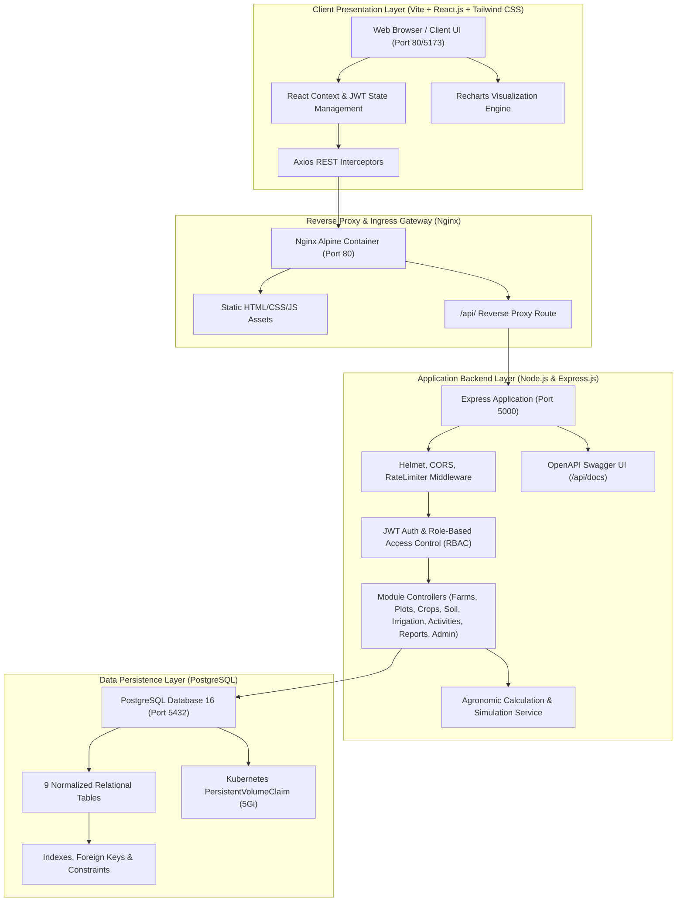
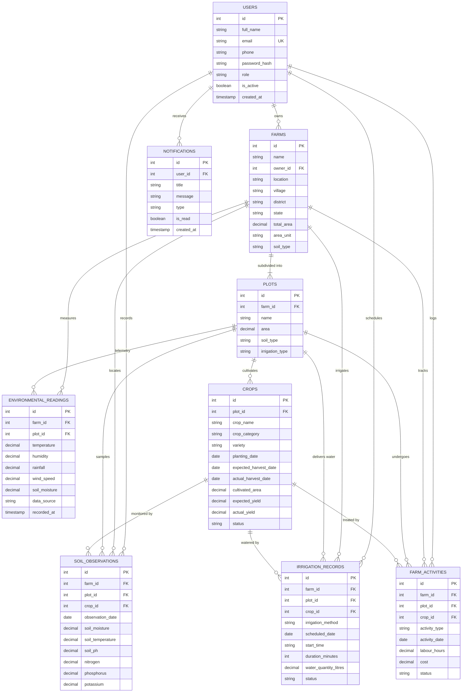
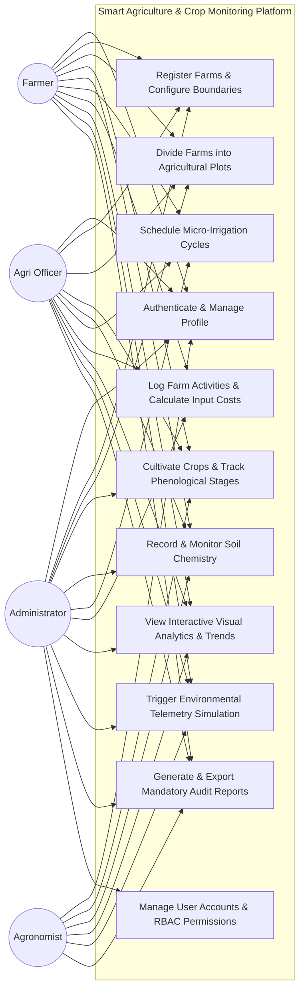
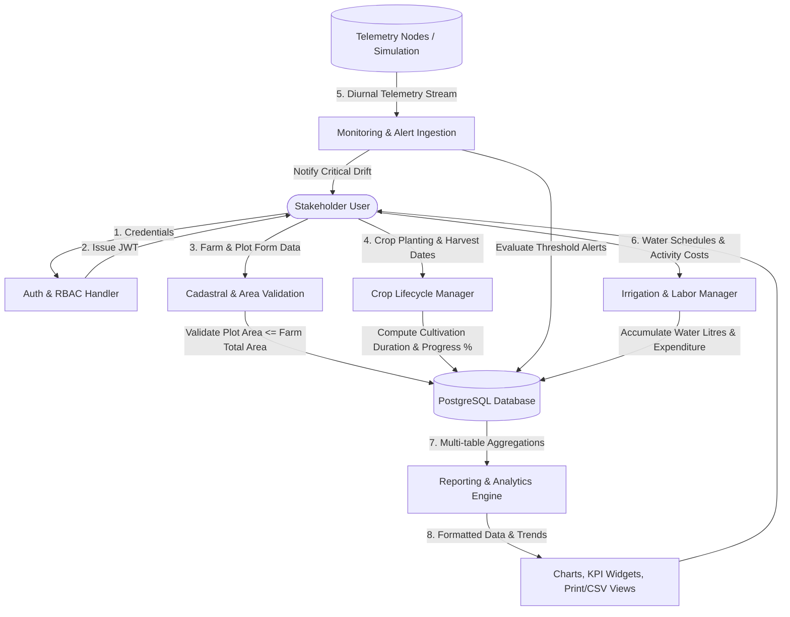

# System Architecture & Technical Diagrams
## Smart Agriculture and Crop Monitoring Dashboard
**Project No. 60 | Department of Computer Science and Engineering | SR University**

---

## 1. High-Level System Architecture Diagram

---

## 2. Entity-Relationship (ER) Diagram

---

## 3. Use Case Diagram

---

## 4. Data Flow Diagram (Level 1)

